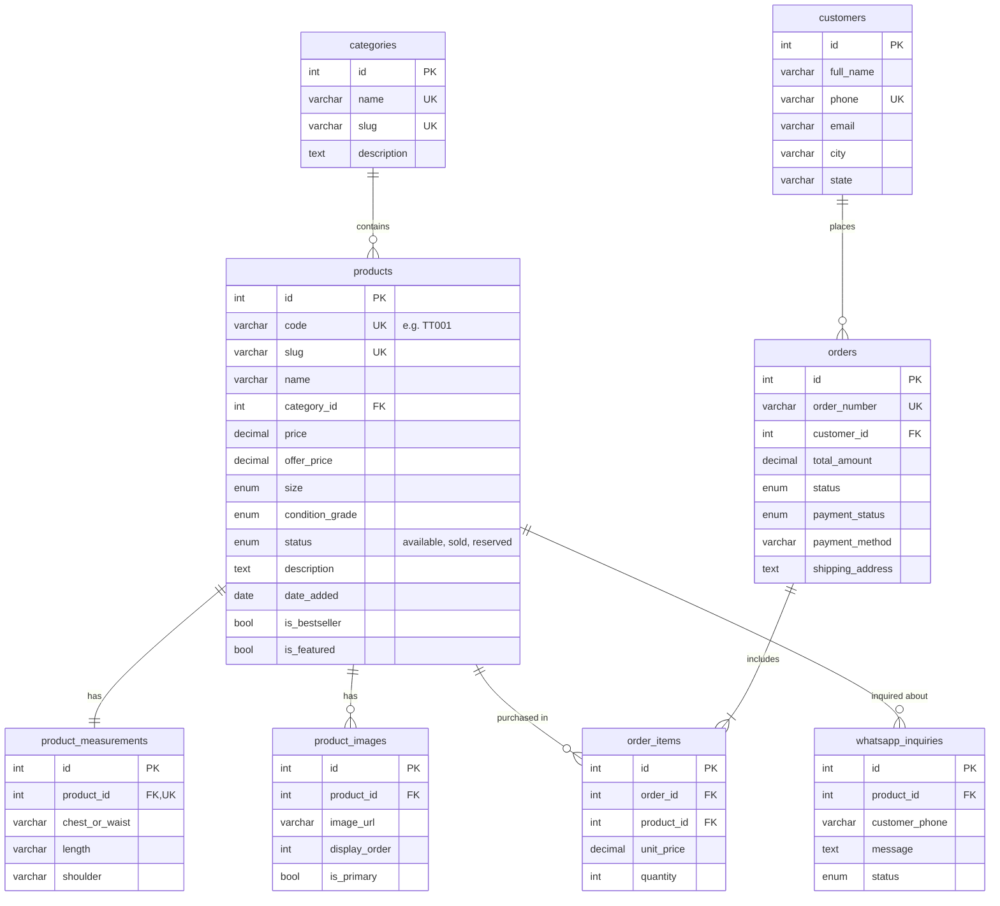

# Thrift Tamilan - E-Commerce SQL Database Documentation

This directory contains full database schemas, initial seed data, and operational queries for the **Thrift Tamilan** e-commerce platform.

---

## 📁 File Structure

| File | Dialect / Target | Description |
| :--- | :--- | :--- |
| [`thrift_tamilan.sqlite`](file:///c:/Users/keerthiv/Downloads/E-commerce/e-commerce-ws/database/thrift_tamilan.sqlite) | **Active SQLite DB** | **Connected to the website via [`src/lib/db.ts`](file:///c:/Users/keerthiv/Downloads/E-commerce/e-commerce-ws/src/lib/db.ts)!** |
| [`mysql_schema.sql`](file:///c:/Users/keerthiv/Downloads/E-commerce/e-commerce-ws/database/mysql_schema.sql) | MySQL 8.0+ / MariaDB | Production schema with `AUTO_INCREMENT`, ENUMs, foreign keys & indexes |
| [`postgres_schema.sql`](file:///c:/Users/keerthiv/Downloads/E-commerce/e-commerce-ws/database/postgres_schema.sql) | PostgreSQL / Supabase / Neon | Postgres schema with custom ENUM types, triggers for `updated_at`, check constraints |
| [`sqlite_schema.sql`](file:///c:/Users/keerthiv/Downloads/E-commerce/e-commerce-ws/database/sqlite_schema.sql) | SQLite / Cloudflare D1 / Turso | Lightweight local or edge-database schema |
| [`seed_data.sql`](file:///c:/Users/keerthiv/Downloads/E-commerce/e-commerce-ws/database/seed_data.sql) | Universal ANSI SQL | Inserts all 12 products from `products.json`, categories, measurements, images, and sample customers/orders |
| [`queries.sql`](file:///c:/Users/keerthiv/Downloads/E-commerce/e-commerce-ws/database/queries.sql) | Universal ANSI SQL | Ready-to-use queries for catalogue browsing, detail views, sales analytics, and WhatsApp inquiries |

---

## 🗄️ Database Schema Design (Entity Relationship)



---

## 🚀 How to Import and Run

### 1. MySQL / MariaDB / XAMPP / phpMyAdmin

#### Using Command Line:
```bash
# 1. Login to MySQL and create/import schema
mysql -u root -p < database/mysql_schema.sql

# 2. Populate tables with seed data
mysql -u root -p thrift_tamilan_db < database/seed_data.sql
```

#### Using phpMyAdmin:
1. Open phpMyAdmin (`http://localhost/phpmyadmin`).
2. Go to the **Import** tab.
3. Choose `database/mysql_schema.sql` and click **Go**.
4. Once created, select `thrift_tamilan_db` database, go to **Import**, choose `database/seed_data.sql` and click **Go**.

---

### 2. PostgreSQL / Supabase / Neon

#### Using `psql`:
```bash
# 1. Create database
createdb thrift_tamilan_db

# 2. Run schema
psql -d thrift_tamilan_db -f database/postgres_schema.sql

# 3. Insert seed data
psql -d thrift_tamilan_db -f database/seed_data.sql
```

#### Using Supabase / Neon SQL Editor:
1. Open your project's **SQL Editor** tab.
2. Paste the contents of `database/postgres_schema.sql` and run.
3. Paste the contents of `database/seed_data.sql` and run.

---

### 3. SQLite (Zero Configuration / Embedded)

```bash
# 1. Initialize SQLite database file
sqlite3 thrift_tamilan.sqlite < database/sqlite_schema.sql

# 2. Load seed records
sqlite3 thrift_tamilan.sqlite < database/seed_data.sql
```

---

## ⚡ Connecting to your Astro / Node.js Backend

If you wish to query the database directly from Astro API routes or Server-Side Rendered (SSR) pages:

### Option A: PostgreSQL with `pg` / Supabase
```ts
// src/lib/db.ts
import { Pool } from 'pg';

export const pool = new Pool({
  connectionString: process.env.DATABASE_URL,
});

export async function getAvailableProducts() {
  const { rows } = await pool.query(`
    SELECT p.*, c.name AS category_name, img.image_url AS primary_image
    FROM products p
    JOIN categories c ON p.category_id = c.id
    LEFT JOIN product_images img ON p.id = img.product_id AND img.is_primary = TRUE
    WHERE p.status = 'available'
    ORDER BY p.date_added DESC;
  `);
  return rows;
}
```

### Option B: MySQL with `mysql2/promise`
```ts
// src/lib/db.ts
import mysql from 'mysql2/promise';

export const pool = mysql.createPool({
  host: 'localhost',
  user: 'root',
  password: 'your_password',
  database: 'thrift_tamilan_db',
});
```

### Option C: SQLite with `better-sqlite3`
```ts
// src/lib/db.ts
import Database from 'better-sqlite3';

const db = new Database('thrift_tamilan.sqlite');
export function getAvailableProducts() {
  return db.prepare(`
    SELECT p.*, c.name AS category_name, img.image_url AS primary_image
    FROM products p
    JOIN categories c ON p.category_id = c.id
    LEFT JOIN product_images img ON p.id = img.product_id AND img.is_primary = 1
    WHERE p.status = 'available'
    ORDER BY p.date_added DESC
  `).all();
}
```
